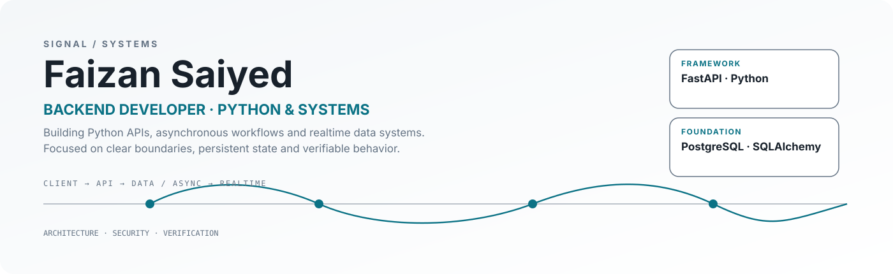
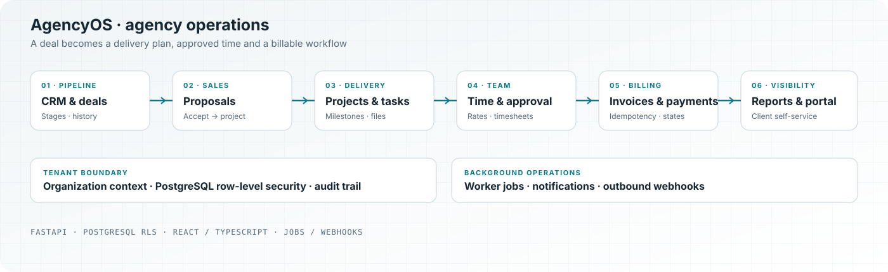
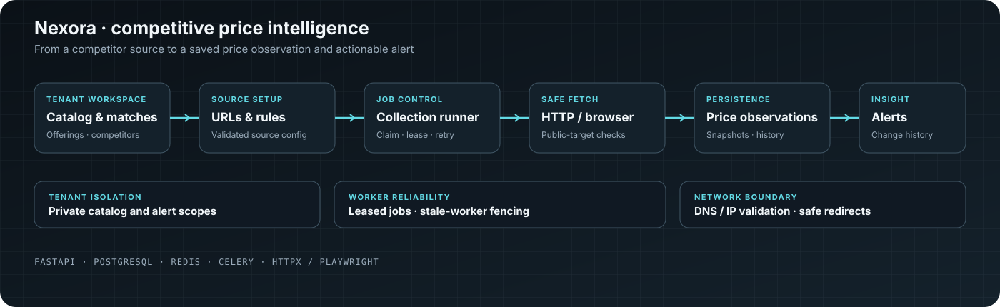
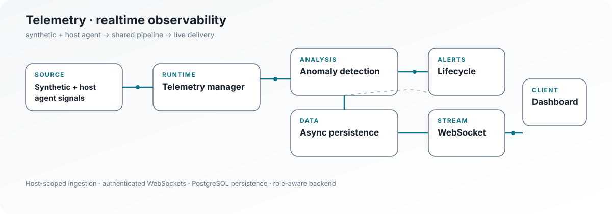
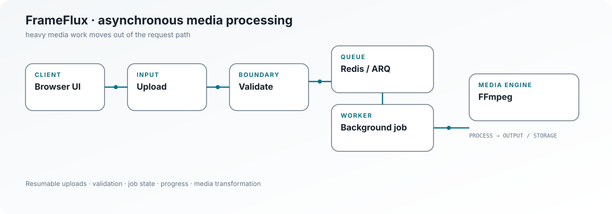

  <picture>
    <source media="(prefers-color-scheme: dark)" srcset="./assets/profile/hero-dark.svg">
    <source media="(prefers-color-scheme: light)" srcset="./assets/profile/hero-light.svg">
    
  </picture>

  <a href="https://faizansaiyed123.github.io/portfolio/">Portfolio</a> ·
  <a href="https://www.linkedin.com/in/faizan-saiyed-52b289228/">LinkedIn</a> ·
  <a href="#open-source-contributions">Open-source contributions</a> ·
  <a href="./docs/ENGINEERING.md">Engineering evidence</a> ·
  <a href="https://github.com/faizansaiyed123?tab=repositories">All repositories</a>

## I build the systems behind products

I build full-stack products with a backend-first focus: domain APIs, relational data, authentication and authorization, background jobs, third-party integrations, and the interfaces that connect them. My strongest work goes beyond CRUD screens into connected business workflows, tenant boundaries, and reliable state transitions.

<strong>Multi-tenant SaaS · Python APIs · PostgreSQL · Background workers · Realtime systems</strong>

## Featured systems

### AgencyOS — Agency operations platform

An end-to-end agency workflow connecting CRM and deals with proposals, project delivery, team time, invoicing, reporting, and a client portal.

<picture>
  <source media="(prefers-color-scheme: dark)" srcset="./assets/profile/agencyos-dark.svg">
  <source media="(prefers-color-scheme: light)" srcset="./assets/profile/agencyos-light.svg">
  
</picture>

- Proposal acceptance links sales state to project delivery.
- Organization context, PostgreSQL row-level security, audit records, explicit state transitions, and atomic billing operations.
- Background jobs, notifications, webhooks, timesheets, invoice generation, and client access.

**Stack:** FastAPI · PostgreSQL / RLS · SQLAlchemy · React · TypeScript

[Frontend](https://github.com/faizansaiyed123/agencyos_frontend) · [Backend](https://github.com/faizansaiyed123/agencyos_backend)

<strong>Implementation paths</strong>

[Proposal workflow](https://github.com/faizansaiyed123/agencyos_backend/blob/main/app/modules/proposals/service.py) · [Billing service](https://github.com/faizansaiyed123/agencyos_backend/blob/main/app/modules/billing/service.py) · [TOTP MFA](https://github.com/faizansaiyed123/agencyos_backend/blob/main/app/modules/identity/mfa.py) · [Worker](https://github.com/faizansaiyed123/agencyos_backend/blob/main/app/worker.py)

---

### Service Agreement Manager — Service-business operations

A workflow platform for HVAC, plumbing, and related trades, connecting customer equipment and service locations to agreements, renewals, maintenance, work orders, billing, and reporting.

- Agreement management, maintenance schedules, work orders, equipment records, and customer imports.
- Recurring invoices, invoice PDFs, payment/refund/credit flows, exports, and billing events.
- Separate maintenance, billing, notification, SMS, and webhook workers; company-scoped records and cookie-based browser sessions.

**Stack:** FastAPI · PostgreSQL · SQLAlchemy · Alembic · React · Vite · Docker

[Frontend](https://github.com/faizansaiyed123/service-agreement-manager-frontend) · [Backend](https://github.com/faizansaiyed123/service-agreement-manager-backend) · [Product walkthrough](https://github.com/faizansaiyed123/service-agreement-manager-frontend/blob/main/visual.md)

<strong>Implementation paths</strong>

[Agreement API](https://github.com/faizansaiyed123/service-agreement-manager-backend/blob/main/app/api/agreements.py) · [Maintenance rules](https://github.com/faizansaiyed123/service-agreement-manager-backend/blob/main/app/services/maintenance.py) · [Recurring billing worker](https://github.com/faizansaiyed123/service-agreement-manager-backend/blob/main/app/workers/billing.py) · [Webhook signing](https://github.com/faizansaiyed123/service-agreement-manager-backend/blob/main/app/core/webhook_crypto.py)

---

### Nexora — B2B competitive price intelligence

A multi-tenant workspace for private product catalogs, competitors, collection sources, offering matches, price observations, discovery jobs, and change alerts.

- Scheduled collection with atomic job claims, leases, and fencing tokens.
- Price observations, snapshots, job history, and tenant-scoped alerts.
- URL validation, public-address checks, redirects, HTTP collection, and browser-based discovery.

**Stack:** FastAPI · async SQLAlchemy · PostgreSQL · Redis · Celery · HTTPX · Playwright · React

[Frontend](https://github.com/faizansaiyed123/Nexora-Frontend) · [Backend](https://github.com/faizansaiyed123/Nexora-backend)

<strong>Implementation paths</strong>

[Collection API](https://github.com/faizansaiyed123/Nexora-backend/blob/main/src/backend/api/v1/collections.py) · [Collection runner](https://github.com/faizansaiyed123/Nexora-backend/blob/main/src/backend/services/collection_runner.py) · [Discovery service](https://github.com/faizansaiyed123/Nexora-backend/blob/main/src/backend/services/discovery_service.py) · [URL validation](https://github.com/faizansaiyed123/Nexora-backend/blob/main/src/backend/services/url_security.py)

---

### Telemetry — Realtime infrastructure observability

A platform combining synthetic signals and a repository-provided host agent through one telemetry pipeline.

<picture>
  <source media="(prefers-color-scheme: dark)" srcset="./assets/profile/telemetry-dark.svg">
  <source media="(prefers-color-scheme: light)" srcset="./assets/profile/telemetry-light.svg">
  
</picture>

- Bounded ingestion, host-scoped keys, sequence deduplication, anomaly detection, and sustained alert rules.
- Incident correlation, SLO/error-budget evaluation, audit history, signed notifications, and delivery replay.
- Authenticated WebSockets and a realtime processing path separated from database writes.

**Stack:** FastAPI · PostgreSQL · SQLAlchemy · WebSockets · psutil · React · TypeScript

[Frontend](https://github.com/faizansaiyed123/telemetry-frontend) · [Backend](https://github.com/faizansaiyed123/telemetry-backend)

---

### FrameFlux — Asynchronous media processing

A media-processing platform that moves video, audio, and image work out of HTTP requests and into background jobs.

<picture>
  <source media="(prefers-color-scheme: dark)" srcset="./assets/profile/frameflux-dark.svg">
  <source media="(prefers-color-scheme: light)" srcset="./assets/profile/frameflux-light.svg">
  
</picture>

- Direct and resumable chunked uploads with processing status and progress tracking.
- FFmpeg probe/transcode, clip, trim, split, merge, watermark, and overlay operations.
- Upload size/type/signature checks; PostgreSQL metadata and Redis/ARQ job coordination.

**Stack:** FastAPI · PostgreSQL · Redis / ARQ · FFmpeg · Next.js · TypeScript

[Frontend](https://github.com/faizansaiyed123/FrameFlux-Frontend) · [Backend](https://github.com/faizansaiyed123/FrameFlux-Backend)

---

### SupportAI — Knowledge-grounded support assistant

A support platform combining organization knowledge, document ingestion, retrieval-augmented generation, cited answers, conversations, and ticket workflows, with a local Ollama model runtime.

- Background extraction, chunking, embeddings, hybrid search, and reranking.
- Cited responses, low-confidence handling, and explicit treatment of retrieved documents as untrusted reference data.
- Organization-scoped conversations, knowledge documents, customers, and tickets.

**Stack:** FastAPI · PostgreSQL / pgvector · Ollama · Procrastinate · Next.js

[Frontend](https://github.com/faizansaiyed123/supportai_frontend) · [Backend](https://github.com/faizansaiyed123/supportai_backend)

<strong>Implementation paths</strong>

[RAG orchestration](https://github.com/faizansaiyed123/supportai_backend/blob/main/app/services/rag.py) · [Hybrid retrieval](https://github.com/faizansaiyed123/supportai_backend/blob/main/app/services/retrieval.py) · [Document worker](https://github.com/faizansaiyed123/supportai_backend/blob/main/app/workers/ingestion.py)

## More full-stack products

The featured write-ups above go deeper on selected systems. This index brings the other major products together and keeps quick links to the flagship platforms easy to find.

| Project | Main engineering scope | Repositories |
|---|---|---|
| **AgencyOS** | Agency operations from CRM and proposals through project delivery, team time, billing, reporting, and client portal. | [Frontend](https://github.com/faizansaiyed123/agencyos_frontend) · [Backend](https://github.com/faizansaiyed123/agencyos_backend) |
| **Nexora** | Multi-tenant competitive price intelligence, leased collection jobs, price observations, discovery, and alerts. | [Frontend](https://github.com/faizansaiyed123/Nexora-Frontend) · [Backend](https://github.com/faizansaiyed123/Nexora-backend) |
| **Telemetry** | Host-agent ingestion, anomaly detection, correlated incidents, SLOs, and realtime WebSocket delivery. | [Frontend](https://github.com/faizansaiyed123/telemetry-frontend) · [Backend](https://github.com/faizansaiyed123/telemetry-backend) |
| **Autofix** | Automotive service workflows covering appointments, inspections, repair orders, estimates, invoices, payments, inventory, and customer portal. | [Frontend](https://github.com/faizansaiyed123/autofix_frontend) · [Backend](https://github.com/faizansaiyed123/autofix_backend) |
| **Cleanflow** | Business operations covering customers, contracts, leads, jobs, invoices/payments, audit history, and notifications. | [Frontend](https://github.com/faizansaiyed123/cleanflow_frontend) · [Backend](https://github.com/faizansaiyed123/cleanflow_backend) |
| **Sayphora** | Full-stack beauty and cosmetics commerce: catalogue, cart and server-side pricing, orders, stock, reviews, wishlist, loyalty, promotions, AI beauty tools, and admin analytics. | [Repository](https://github.com/faizansaiyed123/Sayphora) · [Product walkthrough](https://github.com/faizansaiyed123/Sayphora/tree/main/docs/project-walkthrough) |
| **PrintOscar** | E-commerce storefront and admin workflows for products, cart, wishlist, orders, inventory, order tracking, reviews, refunds, and payments. | [Frontend](https://github.com/faizansaiyed123/print_oscor_frontend) · [Backend](https://github.com/faizansaiyed123/print_oscor_backend) |
| **Fieldline CRM** | Sales pipeline, relationship health, explainable operational intelligence, data quality, automation, imports, merge history, and saved views. | [Frontend](https://github.com/faizansaiyed123/fieldline-crm-frontend) · [Backend](https://github.com/faizansaiyed123/fieldline-crm-backend) |
| **Feature Flag Platform** | Organization/project-scoped flags, targeting, deterministic rollouts, environment controls, and scoped SDK keys. | [Demo](https://feature-flag-platform-frontend-lsf9.vercel.app/) · [Frontend](https://github.com/faizansaiyed123/feature-flag-platform-frontend) · [Backend](https://github.com/faizansaiyed123/feature-flag-platform-backend) |
| **Product Analytics** | Event ingestion and deduplication, identity merging, project keys, access-scoped analytics queries, and exports. | [Frontend](https://github.com/faizansaiyed123/product_analytics_frontend) · [Backend](https://github.com/faizansaiyed123/product_analytics_backend) |
| **LedgerPulse** | Organization-aware invoicing, expenses, customers/vendors, payments, recurring invoices, and scheduled operations. | [Frontend](https://github.com/faizansaiyed123/ledgerpulse_frontend) · [Backend](https://github.com/faizansaiyed123/ledgerpulse_backend) |
| **Marketing Campaign Management** | Campaign scheduling, audiences, durable email delivery, failed-recipient retries, unsubscribe checks, tracking, and reporting. | [Frontend](https://github.com/faizansaiyed123/marketing-campaign-management-frontend) · [Backend](https://github.com/faizansaiyed123/marketing-campaign-management-backend) |
| **Flow Desk** | Tenant-scoped clients, projects, tasks, time entries, invoices, API keys, and webhooks. | [Frontend](https://github.com/faizansaiyed123/flow-desk_frontend) · [Backend](https://github.com/faizansaiyed123/flow-desk_backend) |
| **Jeca Real Estate** | Real estate product with property pages, leads, agent/admin workspaces, and IDX integration plumbing. | [Frontend](https://github.com/faizansaiyed123/jeca-real-estate-frontend) · [Backend](https://github.com/faizansaiyed123/jeca-real-estate-backend) |

## Open-source contributions

Merged contributions to established projects:

- [**Sentry JavaScript #25488 — Cloudflare Workers KV instrumentation**](https://github.com/getsentry/sentry-javascript/pull/25488) — tracing instrumentation for KV operations.
- [**TrustFlow SDK #586 — Export `isWalletRejection`**](https://github.com/trustflow-protocol/trustflow-sdk/pull/586) — public wallet entry-point export with regression coverage.
- [**Sentry JavaScript #25357 — Export the `LoaderSentry` type**](https://github.com/getsentry/sentry-javascript/pull/25357) — TypeScript type for the CDN loader interface.
- [**Sentry Python #7825 — Move active-thread tracking into Starlette**](https://github.com/getsentry/sentry-python/pull/7825) — centralizes sync-handler thread tracking.

## Technical toolkit

| Area | Technologies |
|---|---|
| Backend | Python · FastAPI · Flask · Pydantic · REST · OAuth2 / JWT |
| Data and async | PostgreSQL · SQLAlchemy · Alembic · Redis · ARQ · Celery · Procrastinate |
| Realtime and processing | WebSockets · Server-Sent Events · FFmpeg · background workers |
| Frontend | React · Next.js · TypeScript · Vite · Tailwind CSS |
| Delivery and verification | Docker · GitHub Actions · Pytest · integration testing · Playwright |

I prefer implementation evidence over arbitrary performance numbers, user counts, or decorative statistics. The [engineering evidence guide](./docs/ENGINEERING.md) maps major profile claims to the code that implements them.

<strong>Backend Developer · Python APIs · Full-Stack Systems</strong>
